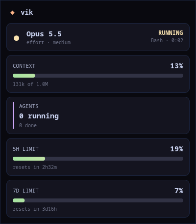

# claude-waybar

A [Waybar](https://github.com/Alexays/Waybar) module that shows what your Claude Code sessions are doing, so you can work on another workspace and still know when Claude needs you.

<p align="center"></p>

## What it shows

In the bar, one dot per running session plus the most recent session's activity and a context gauge (green to red):

| Dot | State |
| --- | --- |
| blue | idle |
| yellow | running (the label shows `thinking` or the current tool) |
| purple | waiting for you (finished its turn, or asking for a permission) |

A session that has been waiting for 10 minutes goes back to idle.

- **Left click**: details popup (model, effort, state and how long, context used of the window, running/finished subagents, 5-hour and 7-day plan limits with reset times). Esc, a click on the popup, or another click on the bar closes it.
- **Right click**: focus the terminal window of the most recently active session (Hyprland).
- **Hover**: one line per session.

## How it works

Claude Code calls two small scripts, nothing runs in the background:

- `claude-waybar-hook` is registered as an async hook on session, prompt, tool, notification, stop and subagent events. It writes one JSON file per session to `$XDG_RUNTIME_DIR/claude-waybar/` and sends waybar `SIGRTMIN+9` so the module redraws immediately.
- `claude-waybar-statusline` is registered as the `statusLine` command. It saves the status payload (model, effort, context window, rate limits) next to it and prints nothing, or passes the payload through to the statusLine you already had.

`claude-waybar data` merges both for waybar, `claude-waybar popup` opens the GTK4 layer-shell panel, `claude-waybar focus` walks up from the session's process to its window.

Sessions are dropped when their `claude` process exits or on `SessionEnd`. The 5h/7d limits only appear on Claude subscription plans (Claude Code includes `rate_limits` in the statusLine payload there).

## Requirements

Claude Code 2.1+, Waybar, `jq`, Python 3 with `python-gobject`, `gtk4`, `gtk4-layer-shell` (popup), Hyprland for right-click focus.

Arch: `pacman -S waybar jq python-gobject gtk4 gtk4-layer-shell`

## Install

```bash
git clone https://github.com/Ardet696/claude-waybar.git
cd claude-waybar
./install.sh
```

The installer symlinks `bin/*` into `~/.local/bin` and registers the hooks and statusLine in `~/.claude/settings.json` (backup in `settings.json.claude-waybar-bak`). Your existing hooks are kept and an existing statusLine keeps working.

Then wire up waybar:

1. Add the contents of `waybar/module.jsonc` to your waybar config (or `include` it) and put `"custom/claude"` in `modules-left`, `modules-center` or `modules-right`.
2. Append `waybar/style.css` to your waybar `style.css`.
3. `pkill -SIGUSR2 waybar`

Sessions started after the install show up on their own. Already open sessions pick up the new settings too, but appear only once they fire their next event.

Uninstall with `./install.sh --uninstall`.

## Configuration

| Variable | Default | Where | What |
| --- | --- | --- | --- |
| `CLAUDE_WAYBAR_POPUP_X` | `330` | waybar's environment | Popup distance from the left screen edge, in px |
| `CLAUDE_WAYBAR_SIGNAL` | `9` | Claude Code's environment | Realtime signal sent to waybar; must match `"signal"` in the module |

## License

MIT
